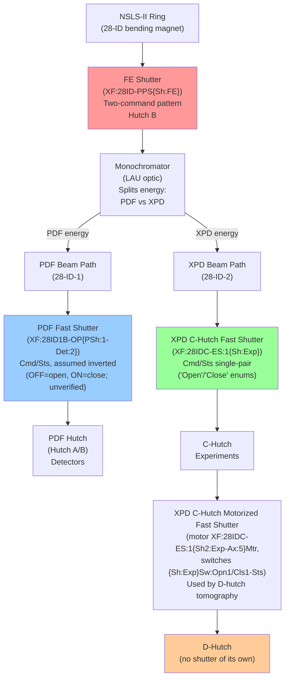

# 28-ID Shutter System Architecture

**Purpose:** Canonical reference for the beam shutter topology, PV addresses, and control logic across PDF (28-ID-1) and XPD (28-ID-2) beamlines. This document guides fast-shutter PR development, operation manuals, and CS-Studio screen corrections.

**Status:** PVs extracted and verified from CS-Studio screens on 2026-11-17:
- **PDF fast shutter** (`XF:28ID1B-OP{PSh:1-Det:2}`): verified in 28id1-phoebus/ut/28id1-ut.bob
- **XPD FE shutter** (`XF:28ID-PPS{Sh:FE}`): verified in 28id2-phoebus/pps/28id_pps_layout.bob
- **XPD C-hutch fast shutter** (`XF:28IDC-ES:1{Sh:Exp}`): verified in 28id2-phoebus/es/28idc_fast_shutter.bob

Diagram scope: topology + control PV addresses + feedback readback patterns.

---

## Beam Path Diagram (Mermaid)



---

## Beam Path Topology

```
NSLS-II ring 
    ↓ (all beams to 28-ID)
    
FE Shutter (Front End, Hutch B)
    ↓ (gates all downstream 28-ID)
    
Monochromator (LAU optic splits PDF vs XPD energy)
    ├─→ PDF path → Fast Shutter (Hutch A/B) → PDF Hutch (28-ID-1)
    │
    └─→ XPD path → Fast Shutter (C-hutch) → XPD C-hutch (28-ID-2)
                   → C-hutch motorized fast shutter ({Sh2:Exp}) → XPD D-hutch (no shutter of its own)
```

---

## Shutter Devices & PV Addresses

### 1. FE Shutter (Front End, Hutch B)

**Function:** Gates beam to both PDF and XPD. Used in both beamlines' tomo and XRD plans.

| Property | Value |
|----------|-------|
| **Physical location** | Hutch B (upstream of monochromator) |
| **Device class** | `Shutter` in both XPD-D profiles (#63). `PPSShutter(Shutter)` adds the interlock acknowledge and would fit better (follow-on) |
| **PV prefix** | `XF:28ID-PPS{Sh:FE}` ✓ |
| **Control commands** | `{Cmd:Opn-Cmd}` (open), `{Cmd:Cls-Cmd}` (close) |
| **Feedback readback** | `{Pos-Sts}` (position status: "Open" / "Not Open") |
| **Settle time** | **? UNKNOWN** — _Ask Kyle_ |
| **Used in** | xpdtools tomo plans (fe_shutter device) |
| **Status enum** | `ShutterStatus` = {OPEN: "Open", CLOSED: "Not Open"} |
| **Source** | CS-Studio: 28id2-phoebus/pps/28id_pps_layout.bob |
| **Verification** | ✓ PV extracted from screen; **settle time & control response time still need measurement** |

**Device instantiation** (`profiles/xpdd.py` on `xpdd-tomo` `0889d26`):
```python
from xpd_tools.shutter import Shutter
fe_shutter = Shutter("XF:28ID-PPS{Sh:FE}", name="fe_shutter")
```

**🔴 PENDING KYLE'S CONFIRMATION:**
1. Is PV `XF:28ID-PPS{Sh:FE}` correct?
2. How long does FE shutter settle after opening/closing? (Need for plan timing)

---

### 2. PDF Fast Shutter (Hutch A/B, before PDF Hutch)

**Function:** Protects PDF detectors and optics from beam. Used in PDF XRD plans.

| Property | Value |
|----------|-------|
| **Physical location** | Hutch A/B (between monochromator and PDF experimental hutch) |
| **Device class** | `FastShutter` (ophyd_async, inverted logic) |
| **PV prefix** | `XF:28ID1B-OP{PSh:1-Det:2}` ✓ |
| **Control command** | `{Cmd}`: pdftools writes OFF to open, ON to close (not yet verified) |
| **Feedback readback** | `{Sts}`: pdftools reads OFF as open (not yet verified) |
| **Settle time** | 0.1 s (soft timeout after move) |
| **Used in** | pdftools profiles, PDF XRD plans |
| **Status enum** | `OnOff` = {OFF, ON} |
| **Source** | pdftools/profiles/collection.py |

**Device instantiation** (pdftools profile):
```python
from pdftools.shutter import FastShutter
fs = FastShutter("XF:28ID1B-OP{PSh:1-Det:2}", name="fs")
```

**Note:** pdftools treats the PDF fast shutter as **inverted** (OFF opens, ON closes). That mapping is not yet
confirmed against the physical state; see the status summary below.

---

### 3. XPD C-Hutch Fast Shutter

**Function:** Protects XPD C-hutch detectors and optics from beam. Used in XPD tomo and XRD plans.

| Property | Value |
|----------|-------|
| **Physical location** | C-hutch (between monochromator and XPD C-hutch experimental station) |
| **Device class** | **None yet.** xpd-tools' `Shutter` uses `Pos-Sts`, `Cmd:Opn-Cmd` and `Cmd:Cls-Cmd`, which this shutter does not have; a Cmd/Sts device is pending |
| **PV prefix** | `XF:28IDC-ES:1{Sh:Exp}` ✓ |
| **Control PV** | `{Cmd-Cmd}` (single command: "Open" / "Close") |
| **Feedback readback** | `{Sts-Sts}` (shows current state: "Open" / "Close") |
| **Settle time** | **? UNKNOWN** — needs measurement |
| **Used in** | Not used by xpd-tools. The profiles' `photon_shutter` is `XF:28IDA-PPS{PSh}`, and the D-hutch plans move the motorized shutter of section 4 |
| **Status values** | "Open" / "Close" (string enum) |
| **Source** | CS-Studio: 28id2-phoebus/es/28idc_fast_shutter.bob |
| **Verification** | ✓ **CONFIRMED LIVE** (2026-11-17): `Sts-Sts`="Open", `Cmd-Cmd`="Close" |

**Control Pattern (Cmd/Sts style):**
```
Command: XF:28IDC-ES:1{Sh:Exp}Cmd-Cmd  (write "Open" or "Close")
Status:  XF:28IDC-ES:1{Sh:Exp}Sts-Sts  (read current state)
```

**Device instantiation:** none. `Shutter("XF:28IDC-ES:1{Sh:Exp}")` would connect to `Pos-Sts` and `Cmd:Opn-Cmd` /
`Cmd:Cls-Cmd`, which do not exist here; it needs a device that writes "Open"/"Close" to `Cmd-Cmd` and reads `Sts-Sts`.
Whether this pair and the motorized shutter of section 4 are one physical shutter is not confirmed (the Phoebus screen
commands `{Sh2:Exp}Cmd-Cmd` and reads `{Sh:Exp}Sts-Sts`).

**🟢 CONFIRMED:**
- ✓ PV prefix: `XF:28IDC-ES:1{Sh:Exp}`
- ✓ Control pattern: `{Cmd-Cmd}` = "Open" / "Close" (single Cmd/Sts pair, not two-command)
- ✓ Status feedback: `{Sts-Sts}` = reads current state
- 🔴 **Settle time:** Still needs measurement

---

### 4. XPD D-Hutch (uses the C-hutch motorized fast shutter)

**Corrected 2026-11-19** (from NSLS2/xpd-tools#63 and the CS-Studio screens). The D hutch has no shutter of its own, but
it is downstream of the C hutch, and its tomography plans open and close the **C-hutch motorized fast shutter**.

| Property | Value |
|----------|-------|
| **Device class** | `FastShutter` (xpd-tools#63): moves the motor itself and reads the position switches |
| **Motor** | `XF:28IDC-ES:1{Sh2:Exp-Ax:5}Mtr` |
| **Position switches** | `XF:28IDC-ES:1{Sh:Exp}Sw:Opn1-Sts`, `Sw:Cls1-Sts` (read "SW Low" when made) |
| **Positions** | #63: open −20°, closed +20° (set by hand at the beamline). The screen `28idc_fast_shutter_motorize` says Open=60°, Close=0°. **Open question** |
| **Source** | `28id/es/28idc_fast_shutter_motorize.opi` shows the `{Sh:Exp}` switches as this shutter's open/closed status; the Phoebus screen commands `{Sh2:Exp}Cmd-Cmd` and reads `{Sh:Exp}Sts-Sts` (cs-studio-xf as of 2026-10-20, not refreshed) |
| **Settle time** | Not needed: `FastShutter` waits for its switches and checks the motor position |

The front-end and photon shutters are only checked open by the D-hutch plans, never moved.

**Open question: which photon shutter gates XPD?** The profiles check `XF:28IDA-PPS{PSh}`. On `28id_pps_layout.bob`
`{PSh}` sits on the branch labelled "XPD-1" and `XF:28IDA-PPS:2{PSh:2}` on "XPD-2"; section "CS-Studio Screen
Errors" below says the "XPD-1" label really means PDF. If so, XPD's photon shutter is `:2{PSh:2}`. To confirm: read both
`Pos-Sts` while only one branch has beam.

---

## Device Classes & Control Patterns

As in [`xpd_tools/shutter.py`](https://github.com/NSLS2/xpd-tools/blob/0889d26fd55c616ab8af55faf54dfd91c1bb25ab/src/xpd_tools/shutter.py) on `xpdd-tomo` `0889d26`:

### Shutter (base class, two-command PPS style)
- Reads `{Pos-Sts}` as `ShutterStatus` ("Open" / "Not Open"); triggers `{Cmd:Opn-Cmd}` or `{Cmd:Cls-Cmd}`
- Moves to `True` (open) or `False` (closed); readings report a bool
- Used for `fe_shutter` and `photon_shutter`

```python
class Shutter(EpicsDevice, Subscribable[bool], AsyncMovable[bool]):
    status: SignalR[ShutterStatus]         # {Pos-Sts}: "Open" / "Not Open"
    open_cmd: EpicsTriggerableCommand      # {Cmd:Opn-Cmd}
    close_cmd: EpicsTriggerableCommand     # {Cmd:Cls-Cmd}
```

### PPSShutter(Shutter)
- A `Shutter` plus `interlock_ack` (`InterlockAcknowledge`), the acknowledgement needed after a PPS interlock trip
- Not used by the profiles yet (they build `fe_shutter` as a plain `Shutter`)

### FastShutter(Shutter) (motorized, the one the D-hutch plans move)
- Moves the motor `{Sh2:Exp-Ax:5}Mtr` to `open_position` / `closed_position` (−20 / +20 by default)
- Status from the switches `{Sh:Exp}Sw:Opn1-Sts` / `Sw:Cls1-Sts` and the motor position: open or closed only when
  exactly one switch is made and the motor is within tolerance, otherwise unknown

### pdftools FastShutter (Cmd/Sts, PDF)
- One `{Cmd}` / `{Sts}` pair of `OnOff`; pdftools assumes OFF opens and ON closes (see the polarity note below)
- Source: pdftools `shutter.py` (NSLS2/pdftools#7)

```python
class FastShutter(StandardReadable, Movable[str | int]):
    cmd: SignalRW[OnOff]      # {Cmd}
    status: SignalR[OnOff]    # {Sts}
```

---

## Plan Usage

### Tomo plans (`xpd_tools/tomo/flyscans.py`, `xpdd-tomo` `0889d26`)

`tomo_dark_flat`, with the default `use_shutter=True`:

1. Checks that `fe_shutter` and `photon_shutter` are already open, and stops if not. It never opens or closes them.
2. Closes the fast shutter, then takes the `dark` stream.
3. Moves the sample out of the beam (`sample_out_motor` by `sample_out_offset`), opens the fast shutter, then takes the
   `flat` stream.
4. On exit, even on failure, closes the fast shutter, then moves the sample back.

`tomo_flyscan` checks the same two shutters, opens the fast shutter only once everything is armed, and closes it on
exit. With `use_shutter=False` neither plan checks or moves any shutter, so darks then see the beam.

### XRD plans (pdftools)

pdftools' XRD plans (NSLS2/pdftools#10) open the PDF fast shutter for the light frames and close it afterwards. xpd-tools
has no XRD plans.

---

## Known Issues & Future Work

### 1. Real PV Addresses (All Confirmed ✓)

| Shutter | PV Prefix | Source | Status |
|---------|-----------|--------|--------|
| FE (Hutch B) | `XF:28ID-PPS{Sh:FE}` | 28id2-phoebus/pps/28id_pps_layout.bob | ✓ Confirmed |
| PDF fast (Hutch A/B) | `XF:28ID1B-OP{PSh:1-Det:2}` | pdftools profile | ✓ Confirmed |
| XPD C-hutch fast | `XF:28IDC-ES:1{Sh:Exp}` | 28id2-phoebus/es/28idc_fast_shutter.bob | ✓ Confirmed |
| XPD D-hutch | uses the C-hutch motorized fast shutter: motor `XF:28IDC-ES:1{Sh2:Exp-Ax:5}Mtr`, switches `XF:28IDC-ES:1{Sh:Exp}Sw:*1-Sts` | 28idc_fast_shutter_motorize.opi, xpd-tools#63 | ✓ (angles open) |

**Next step:** measure command-to-readback times for the FE and PDF fast shutters. The D-hutch plans need none for
the motorized shutter: `FastShutter` waits for its switches.

### 2. CS-Studio Screen Errors

**Current screens:** `cs-studio-xf/28id` and `cs-studio-xf/28id2-phoebus`

| Issue | Current | Should Be | Priority |
|-------|---------|-----------|----------|
| Top fork label | "XPD-1" | "PDF" | High |
| Bottom fork (XPD) | Missing fast shutter symbol | Add fast shutter symbol | Medium |
| D-hutch | No shutter shown | Correct (none of its own; it uses the C-hutch motorized shutter upstream) | Low |

**Proposed fixes:** File 3 GitHub issues in cs-studio-xf repos to update screens and reference this document.

## Control Pattern Summary

**Three different control patterns across the 28-ID shutter system:**

| Shutter | Control Style | Command PV | Status PV | Control Values |
|---------|-------|-----------|-----------|-------|
| **FE** (`Sh:FE`) | Two-command | `{Cmd:Opn-Cmd}` + `{Cmd:Cls-Cmd}` | `{Pos-Sts}` | Triggerable commands → "Open" / "Not Open" |
| **PDF fast** (`PSh:1-Det:2`) | Cmd/Sts (assumed inverted, unverified) | `{Cmd}` | `{Sts}` | OFF=open, ON=close → "Open" / "Close" |
| **XPD C-hutch** (`{Sh:Exp}`) | Cmd/Sts (standard) | `{Cmd-Cmd}` | `{Sts-Sts}` | "Open" / "Close" → "Open" / "Close" |

**Key difference:** XPD C-hutch is **single Cmd/Sts pair**, NOT two-command. This requires ophyd device that maps string commands, not trigger-based.

---

### 3. The XPD-D profiles' shutters (`xpdd-tomo` `0889d26`)

Both profiles build the same three devices (#63):

| Device | Class | PV | What the plans do |
|---|---|---|---|
| `fe_shutter` | `Shutter` | `XF:28ID-PPS{Sh:FE}` | check it is open |
| `photon_shutter` | `Shutter` | `XF:28IDA-PPS{PSh}` (which branch gates XPD is open, section 4) | check it is open |
| `fast_shutter` | `FastShutter` | motor `XF:28IDC-ES:1{Sh2:Exp-Ax:5}Mtr`, switches `XF:28IDC-ES:1{Sh:Exp}Sw:*1-Sts` | close for darks, open for flats and fly scans |

- `xpdd.py` builds them with `init_devices(mock=XPDTOOLS_RUNNING_IN_CI)`: real devices at the beamline, mocks in CI.
- `devd.py` still builds them with `init_devices(mock=True)`, on purpose until a real-hardware test (Kyle). Until then a
  dark taken from `devd.py` is not protected by a real shutter, whatever the mock reports.

---

## References

- **pdftools/shutter.py** — FastShutter and FilterBank device classes
- **pdftools/profiles/collection.py** — PDF profile startup (fs device)
- **xpdtools/shutter.py** — `Shutter`, `PPSShutter` and `FastShutter` device classes
- **xpdtools/profiles/xpdd.py** — XPD-D tomo profile startup (fe_shutter, photon_shutter)
- **xpdtools/profiles/devd.py** — XPD-D standard profile startup
- **xpdtools/tomo/flyscans.py** — Tomo dark/flat plan (shutter logic)
- **CS-Studio 28id2-phoebus:**
  - `pps/28id_pps_layout.bob` — FE shutter PV definitions
  - `es/28idc_fast_shutter.bob` — XPD C-hutch fast shutter PV definitions
- **hxm_program/DECISIONS.md** — Shutter system decisions and history
- **hxm_program/pages/pdf.html** — PDF beamline overview
- **hxm_program/pages/xpd.html** — XPD beamline overview

---

## Discussion & Feedback

**Status Summary (2026-11-17, corrected 2026-11-22):**

| Item | Status | Measurement |
|------|--------|-----------|
| **FE shutter PV** | ✓ CONFIRMED | `XF:28ID-PPS{Sh:FE}Pos-Sts` = "Open" (xf28idd-ws8) |
| **FE shutter control** | ✓ CONFIRMED | Two-command pattern: `{Cmd:Opn-Cmd}` / `{Cmd:Cls-Cmd}` |
| **FE shutter settle time** | ⏱️ **NEEDED** | Measure close-to-open latency |
| **XPD C-hutch PV** | ✓ CONFIRMED | `XF:28IDC-ES:1{Sh:Exp}Cmd-Cmd` = "Close", `{Sts-Sts}` = "Open" (xf28idd-ws8) |
| **XPD C-hutch control** | ✓ CONFIRMED | **Single Cmd/Sts pair**: `{Cmd-Cmd}` / `{Sts-Sts}` with 'Open'/'Close' enums |
| **XPD C-hutch settle time** | ⏱️ **NEEDED** | Measure close-to-open latency |
| **PDF fast shutter logic** | ❓ **NOT VERIFIED** | pdftools assumes OFF=open, ON=close, but the one live reading (xf28id1-ws3: `{Sts}`="OFF" while reported closed) contradicts it. Read `{Cmd}` and `{Sts}` with the physical state confirmed independently, open and closed, before relying on either mapping |
| **PDF fast shutter intent** | ❓ **CONFIRM** | Is inverted logic intentional design or historical quirk? |
| **XPD C-hutch device class** | ❓ **OPEN** | No xpd-tools class drives the `{Sh:Exp}` Cmd/Sts pair; the D-hutch plans use `FastShutter` instead (#63) |
| **CS-Studio screens** | ✓ ISSUES FOUND | Top-fork mislabel (PDF vs XPD-1), missing XPD D-hutch symbol |

---

**Critical Discovery (2026-11-17):** XPD C-hutch shutter uses **Cmd/Sts single-pair pattern with string enum commands**, NOT two-command. This differs from FE (two-command) and PDF (inverted ON/OFF boolean). Requires different ophyd device class mapping.

**For Kyle:**
- **Measure settle times** for FE and XPD C-hutch shutters (PDF is 0.1s)
- **Confirm**: Is PDF fast shutter inverted logic intentional?
- **Advise**: Which ophyd device class handles string enum Cmd/Sts pattern?

**For xpdtools developers:**
- Done in #63 for `xpdd.py`; `devd.py` keeps mock shutters until a hardware test
- Use this document as reference when writing/updating shutter-related plans
- Link from device docstrings (xpd_tools/shutter.py) to this document

**For Ops/Beamline Staff:**
- Use PV addresses from Section 2 for Phoebus / CSS manual operations
- Refer to Device Classes section when troubleshooting shutter behavior
- File issues with beamline scientist if shutter does not respond as documented

---

**Last updated:** 2026-11-22 by copilot: device classes, plan sequence, profile shutters and PDF polarity corrected against `xpdd-tomo` `0889d26` and pdftools; 2026-11-19 by copilot: D-hutch section corrected from xpd-tools#63 and the CS-Studio screens (was 2026-11-17: live caget measurements, CS-Studio screen inspection, code cross-reference)
