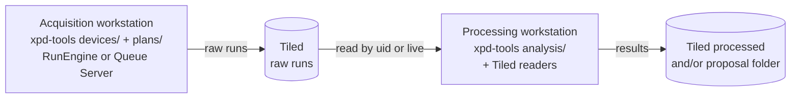

# XPD data processing: where it runs and how it gets its data

Discussion draft (AJ, 2026-11-10). Most xpd-tools work so far is acquisition; this file is for the processing
side. Comment on a line to discuss; answers move into the text.

## Starting points

- **Code stays in xpd-tools.** Acquisition and analysis are separate sections of one package (`devices/`,
  `plans/`, `analysis/`), not separate repos, following "From Profiles to Tested Packages" (Hopkins and
  Wlodek, 2026-10-19). `analysis/` takes arrays in and gives numbers or arrays out. It creates no RunEngine,
  connects no device, reads no environment variable and reads no catalog; reading runs and writing results
  happen outside it.
- **Proposed here:** processing does not run on the acquisition workstations, and it gets its data from
  Tiled.

## What exists today

| Tool | What it does | Where it runs | Data source |
|---|---|---|---|
| pdfstream servers (`pdfstream_servers` Ansible role, pdfstream `v0.5.2-xpd-fixes`) | Live integration to 1D and PDF; save and plot servers; a ZMQ-to-Tiled inserter | `xf28id2-ws1`, `-ws2`, `-ws3`: the acquisition workstations (`xpd_pdf_services.yml` skips the `-qs` hosts) | ZMQ document stream from the RunEngine |
| [xpdAcq](https://github.com/xpdAcq/xpdAcq) (2016-2023) | Acquisition, darks, and calibration (`pyFAI-calib2` on an averaged image) in the user session | The acquisition session | Detector images in the session |
| xpdDacq (D-hutch tomography tools, not in git) | No RunEngine. Writes detector HDF5 plus a job `.yml`; a watcher outside the package calls `process_yml`, which packs darks, flats, counts and scans into netCDF (xarray) and deletes the `.yml` (and, optionally, the HDF5) | The watcher's machine; path rewrites in comments suggest more than one | Files under `/nsls2/data/xpd-new/legacy/raw/xpdd/` |
| xpd-tools | No `analysis/` yet. `autonomous` has `optimization/` (`pdffit`, `scoring`), analysis that steers acquisition | Acquisition session or Queue Server | Live documents |
| [scriptrunner run picker](https://github.com/sligara7/scriptrunner/tree/tiled-run-picker) (AJ's fork of Nghia Vo's scriptrunner) | Optional "Pick run..." button that searches Tiled by date, plan and proposal and fills a script's `uid` or `scan_id` argument; the script reads the run itself | Wherever scriptrunner runs | Tiled |

Nothing in xpdAcq or xpdDacq integrates images to 1D or reconstructs tomography.

## Ways processing could run on its own workstation

None chosen; they can combine.

- **A. On demand.** `analysis/` scripts started from scriptrunner (or the command line) on a processing
  workstation, each taking a run uid and reading the run from Tiled under the account of whoever runs it.
  Good for reprocessing and tomography reconstruction.
- **B. Always on.** A reduction service on a processing host that picks up each run as Tiled receives it
  (bluesky-tiled-plugins streaming). This is pdfstream's job, moved off the acquisition workstations.
- **C. Notebooks** (JupyterHub) reading Tiled, for exploratory work.
- **D. File job queue** as in xpdDacq, on another machine. It needs no Tiled but keeps a second index of the
  data beside Tiled and depends on path layouts.

Costs to weigh:

1. Some processing is needed **at the beamline, in the moment**: a 1D pattern while the sample changes, or a
   value a plan uses to choose its next point. Going through Tiled adds latency the ZMQ path does not have.
2. **Large frames** (tomography stacks) over Tiled's HTTP API may be slow. Tiled can point at the HDF5 files,
   which a host with the filesystem mounted reads directly, so Tiled stays the index without copying the data.
3. Reading Tiled needs **proposal access** for the account doing it. HEX's auto-exporter failed under the
   shared beamline account for exactly this reason (2026-10-26 and 10-29).
4. A processing host has to **exist and have an owner**. Data Engineering owns the Tiled-to-analysis side of
   the DAD/DE split. Reconstruction may want a GPU.

## Proposed requirements

Proposed by AJ (2026-11-10) so that processing is built to these from the start. Not agreed yet: comment on the
line of any you would change. In hextools, an auto-exporter writes a metadata file next to each run so that
scriptrunner can process it later; these requirements replace that with Tiled.

- **R1. Processing reads runs from Tiled.** Every processing step (script, service or notebook) finds its input
  run in Tiled and reads that run's metadata and data from Tiled, by uid or by a Tiled search. It does not read
  them from the acquisition session, its Redis-backed `RE.md`, the ZMQ stream, or files written beside the run
  for processing. Darks, flats and calibration runs are found the same way, through uids the input run carries.
  Anything that needs data sooner than Tiled can give it (feedback to a running plan, or to the scientist in
  the hutch) is an exception, decided and written down on its own.
- **R2. No side files for processing.** Nothing in xpd-tools acquisition writes a file whose purpose is to tell
  processing about a run: no per-run metadata document (like hextools' auto-exporter) and no job file for a
  watcher (like xpdDacq's `.yml`). The detector's own data files, which Tiled references, are not side files.
- **R3. Each run carries what its processing needs.** In its start document: the proposal (`data_session`),
  the sample, the uids of the runs it depends on (as `last_dark_flat_uid` does today), and the calibration or
  a uid that leads to it. In its streams: the data and the positions that index it. And a Tiled spec naming
  the layout (`TomoDarkFlat`, `TomoFlyscan`), so processing can search runs by spec. What each technique's
  processing needs is agreed with whoever processes it **before its plans are final**; a spec's layout changes
  only with a new spec version.
- **R4. Processing runs off the acquisition machines.** Reduction, integration, PDF, reconstruction and
  reprocessing run on a machine other than the acquisition workstations and Queue Server hosts. This does not
  hold today: the pdfstream servers run on `xf28id2-ws1..3`.

For XPD-D, R3 is the question for Mehmet: **what does tomography processing need from each run**, beyond what
the `xpdd-tomo` plans already write (below)?

## D-hutch tomography

Runs from the `xpdd-tomo` plans (`xpd_tools/tomo/`) already carry what processing needs, in Tiled:

- `tomo_dark_flat` writes the `dark` and `flat` streams (spec `TomoDarkFlat`).
- `tomo_flyscan` writes frames and the PandA angle (`rotation_angle`) in `primary` (spec `TomoFlyscan`).
- Each scan's start document names its dark/flat run in `last_dark_flat_uid` / `last_dark_flat_scan_id`.

So a reconstruction script needs only the scan's uid: it reads the scan, follows `last_dark_flat_uid` to the
darks and flats, normalises, builds sinograms and reconstructs. The library is not chosen.

## Questions

1. Which machine processes for XPD-D and for C-hutch, and who owns it?
2. What must stay next to acquisition for live feedback, and what can wait for Tiled?
3. Which account reads Tiled during a beamtime: each person's, or a service account with proposal access?
4. Large frames: read through Tiled's API, or through the files Tiled points to?
5. Where do results go: a processed Tiled catalog, the proposal folder, or both?
6. Should the netCDF that xpdDacq writes stay available as an export, so existing notebooks keep working?
7. Should the pdfstream servers move to the processing host when they move to Tiled streaming?
